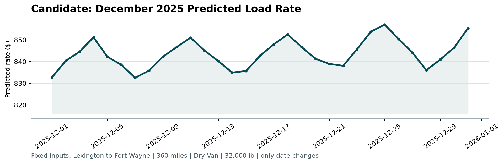

# Freight Rate Prediction

Predicting the posted rate of a truckload from its lane, distance, equipment, weight, date and market signals.

The model is LightGBM on log(rate per mile) with a linear time trend, checked on a time-based holdout (train on Jan-Aug 2025, test on Sep-Oct 2025).

## Results

Holdout: 9,523 loads from Sep-Oct 2025, never seen during training or tuning.

| Model | MAE | MAPE | Within 5% |
|---|---|---|---|
| Baseline (median $/mile per equipment x distance) | $229.14 | 10.49% | 38.4% |
| **LightGBM + trend** | **$102.57** | **4.36%** | **94.8%** |

About 1.3% of the labels are clearly wrong (0.16x to 6.3x the normal price). Excluding those rows, the model's MAE is $51.06 (1.94%).



## Setup

```bash
pip install -r requirements.txt
```

Put the provided data files in `data/` (they are not committed):

```
data/
  train_test.csv
  validation.csv
  december-chart-inputs.csv   # committed, filled with predictions
```

## Running

```bash
python train.py          # holdout metrics, validation_predictions.csv, December predictions
python score.py --predictions validation_predictions.csv --december-predictions data/december-chart-inputs.csv
python experiments.py    # optional, ablation table in results/experiments.csv
```

`python train.py --eval-only` prints the holdout metrics without writing any files.

## Layout

```
train.py                     cleaning, features, holdout evaluation, final fit, predictions
experiments.py               ablations behind the modelling choices
score.py                     provided scorer, validates outputs and draws the December chart
validation_predictions.csv   final predictions for the 12,000 validation loads
results/                     metrics.json, experiments.csv
report/report.docx           write-up
scorer_results/              chart from score.py
```

## Approach

**Cleaning**
- Negative weights are sign errors (same magnitudes as normal weights), so they're made positive.
- Missing weight is filled with the equipment median.
- Missing market_index is filled with that day's mean.
- Loads with $/mile below 0.45x or above 2.5x the equipment median are bad labels and are dropped from training. They are kept when scoring.

**Validation**
- Split by date, because the validation loads all come after the labelled data. A random split would leak future prices.
- Sep-Oct is the holdout. August is used for early stopping, so the holdout is only touched once for the final score.

**Model**
- Target is log(rate per mile), which puts short and long loads on the same scale.
- Huber loss limits the pull of the remaining bad labels.
- Trees can't extrapolate past October. A linear drift (about +0.3% per month) is estimated on the training data, taken out of the target before fitting and added back at prediction time. This lowered holdout MAE from $107.50 to $102.57.

**December chart**
- The chart inputs have no market_index or quote_signal. market_index is set to the daily mean seen in validation.csv and quote_signal to its training median.
